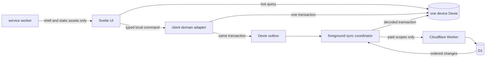

# Maal local-first rewrite specification

Status: implementation-driving v1 specification

Prototype authority: `main` at `74a12ec38f6c297d1a6adbf596234c45212bac11`

Prototype UI authority: the same commit's product routes, components, design tokens, and interaction modules

Decision record: [`../wayfinder/local-first-rewrite/map.md`](../wayfinder/local-first-rewrite/map.md)

## 1. Product and system boundary

Maal is a complete local meal-planning application. Recipes, meals, focused check-ins, taxonomy, preferences,
multiple real local profiles, and file import/export work without a subscription. One household-level **Maal**
plan adds every server-backed feature: D1 synchronization, cross-device household collaboration, MCP, and
future remote compute or integrations.

V1 includes profiles, recipes, meals, households, custom invite codes, import/export, focused check-ins, the
implemented taxonomy and preferences, billing, sync, MCP, and PWA behavior. It excludes groceries, pantry,
anonymous profiles, passkeys, owned-image ingestion/R2, external grocery integrations, bring-your-own storage,
alternate identity providers, prototype-data migration, and marketing work.

Portable file import/export is free and local. Importing a recipe from a remote URL is an existing core Maal
feature, not a future grocery integration; because fetching and parsing arbitrary sites requires Maal's Worker,
it is rate-limited and included in the one paid Maal plan.

The locked stack is SvelteKit, Effect Schema, Dexie/IndexedDB, Cloudflare Workers, D1/Drizzle, WorkOS, Stripe,
the Agents SDK stateless MCP handler, Vitest, and Playwright.

### 1.1 Preserve the finished product UI

This is a data-architecture rewrite, not a product redesign. Every in-scope product surface already implemented
at the prototype authority commit is carried forward with the same information architecture, visual system,
responsive layouts, copy, accessibility behavior, and interactions. Implementers replace server-backed stores
and route data at their seams with Dexie commands and live queries; they do not recreate or reinterpret the UI.

In particular, the dashboard slice reuses `src/lib/interaction/scroll-sdk.ts`, the complete
`src/lib/components/dashboard/*schedule*` family, its drag/drop and keyboard interactions, the calendar and
range-calendar primitives, and their existing tests. Calendar modes, continuous scrolling, retargetable
animation, prepend-position preservation, fast-scroll overlays, meal-pool behavior, and responsive views are
release behavior. Equivalent-looking replacements do not satisfy this requirement.

## 2. Runtime architecture

- Dexie is the only domain source observed by authenticated UI. HTTP results are decoded and committed to
  Dexie before they become visible.
- A client command validates with Effect Schema and atomically writes the aggregate, conflict clock, and
  outbox mutation. Network availability never decides whether a local command succeeds.
- The foreground, profile-scoped coordinator is the v1 correctness path. The service worker is not a fake
  local server and is not between the UI and Dexie.
- The service worker owns application-shell caching, offline navigation, and coordinated updates. Optional
  background sync may later call the same coordinator protocol, but correctness cannot depend on it.
- The Worker authenticates every remote operation, authorizes current WorkOS membership and Maal capability,
  then touches D1. No browser connects to D1 directly.
- Routine free content use performs no Worker or D1 requests. Explicit authentication, billing, and custom
  household-invite administration are permitted remote actions for free users.

### 2.1 Cloudflare resource identity

Cloudflare resource names describe the environment and never include an application or schema version:

| Environment | Worker         | D1             |
| ----------- | -------------- | -------------- |
| Local       | `maal-local`   | `maal-local`   |
| Staging     | `maal-staging` | `maal-staging` |
| Production  | `maal`         | `maal-prod`    |

The tracked Wrangler configuration retains the existing staging and production D1 IDs. Future application and
schema versions migrate these databases in place through the committed forward-only migration chain. They do
not create a replacement D1, copy all records to a release-named database, or rename the production Worker.
The `maal-v1:<environment>` Dexie name and versioned service-worker cache names are browser-local schema/cache
names. They do not identify Cloudflare resources.

## 3. Shared contract conventions

Effect Schema is authoritative at Dexie, D1 mapping, HTTP, import/export, service-worker message, WorkOS,
Stripe, and MCP boundaries. Writers emit the current version; readers support every non-destructively retained
version. Network envelopes support the current and previous protocol version during rollout.

| Contract          | Rule                                                                                                          |
| ----------------- | ------------------------------------------------------------------------------------------------------------- |
| `DomainId`        | Client-generated UUIDv7. WorkOS user, organization, and membership IDs remain WorkOS IDs.                     |
| `UtcInstant`      | RFC 3339 UTC instant ending in `Z`. Reconciliation never uses a timezone-local timestamp.                     |
| `LocalDate`       | `YYYY-MM-DD`, interpreted in the household timezone.                                                          |
| `LocalTime`       | `HH:mm` or `HH:mm:ss`, interpreted in the household timezone.                                                 |
| `Locale`          | BCP 47 string.                                                                                                |
| `TimeZone`        | IANA timezone identifier.                                                                                     |
| `Confidence`      | Real number in inclusive range `[0, 1]`.                                                                      |
| `Position`        | Non-negative integer, unique within the owning ordered collection.                                            |
| Optional pair     | Composite unit IDs and alias scope/ID values are both null or both non-null.                                  |
| Mutable aggregate | `schemaVersion`, `revision`, `createdAt`, `updatedAt`, nullable `deletedAt`, and per-conflict-group clocks.   |
| Conflict clock    | `{ occurredAt, originDeviceId, mutationId }`; `occurredAt` is when the domain edit happened, not upload time. |

Every local and remote error is a tagged Effect error. Payload contents, recipes, PINs, tokens, raw MCP keys,
and mutation bodies must never be logged.

## 4. Identity, profiles, and households

### 4.1 Real users and device-local profiles

A local profile belongs to one real WorkOS user. One browser installation uses one shared database; records
retain user and household ownership fields. Switching profiles changes `uiState.activeProfileId` only and
does not sign another person out.

Each authenticated profile has a random 128-bit auth-slot ID and a distinct path-scoped, host-only,
`Secure; HttpOnly; SameSite=Lax` sealed WorkOS session cookie at `/api/auth-slots/<slot>/`. Dexie stores the
slot ID and safe status projection, never access tokens, refresh tokens, sealed sessions, or cookie keys.
V1 supports eight authenticated slots; signed-out offline profiles do not count.

Hosted AuthKit is tested first for adding a second user without replacing the first session. If it fails,
Maal hosts the login UI and uses documented WorkOS password, Magic Auth, OAuth, and SSO APIs. Both paths produce
the same auth-slot interface. Passkeys are deferred.

A profile PIN is a casual UI gate, not encryption. It never suspends background synchronization for that
profile. A forgotten PIN requires online WorkOS reauthentication. Session expiry marks the profile
`reauthRequired` but leaves all local data usable.

### 4.2 WorkOS authority and cached permissions

WorkOS is authoritative for users, organizations, memberships, roles, and permissions. D1 and Dexie contain
verified projections. Offline commands enforce the last verified projection. If a profile was removed while
offline, the next remote denial stops sync, quarantines its outbox for that household, and detaches the local
snapshot.

Preserve the prototype roles `admin`, `member`, and `child` and permission strings including
`households:write`, `recipes:read`, `recipes:write`, `meals:read`, and `meals:write`, with legacy permission
mapping only during migration. Server authorization uses permissions, not a trusted client role slug.

### 4.3 Sign-out, removal, membership loss, and deletion

- **Switch profile:** local UI state only.
- **Sign out:** revoke exactly that auth slot and keep the offline profile/data.
- **Remove from this device:** confirm, offer export, revoke the slot, remove private recipes/preferences and
  all pending mutations owned by that profile. Shared household aggregates remain if another local member can
  access them. The versions of a removed recipe that a remaining household's live recipe-following meal
  follows stay (§5.2), so the meal keeps showing them, offline and in free use too.
- **Membership revoked:** retain a read-only detached snapshot. It can be exported or explicitly forked with
  new IDs; it never uploads under the former household identity.
- **Delete household:** cancel and refund billing first, then enter 30-day recoverable deletion. Remote access
  stops immediately. Recovery does not recreate a subscription. Final purge removes household content and
  the WorkOS organization while retaining only required financial/idempotency audit identifiers.

## 5. Domain aggregate schemas

The following fields are the v1 Effect-domain fields. D1 uses snake case; Dexie and wire contracts use camel
case. Prototype fields are preserved unless this document explicitly changes them.

### 5.1 User and household

`UserProfile`: `workosUserId`, `locale`, nullable `timezone`, `cachedCookTimeCoefficient`, nullable
`cookTimeCoefficientUpdatedAt`, `createdAt`, `updatedAt`. Prototype trial columns move to dedicated trial
claims.

`Household`: `householdId` (WorkOS organization ID), `locale`, nullable `timezone`, `weekStartsOn`,
`defaultPlannedYield`, nullable `preferredDinnerTime`, `stalenessThresholdMinutes`, nullable `createdByUserId`,
`createdAt`, `updatedAt`. `stalenessThresholdMinutes` is an integer from 1 to 10,080 and defaults to 180
(3 hours); §8.5 defines what it governs. A household record or envelope without the field decodes to the
default.

`HouseholdAppliance`: `id`, `householdId`, `appliance`, `available`, nullable `notes`, `createdAt`, `updatedAt`.
Appliance is one of `oven`, `stovetop`, `microwave`, `air_fryer`, `slow_cooker`, `rice_cooker`, `blender`,
`food_processor`, or `grill`; `(householdId, appliance)` is unique.

`HouseholdInvite`: `id`, `householdId`, `codeHash`, `createdByUserId`, `roleSlug`, nullable `maxUses`,
`usesCount`, `expiresAt`, nullable `revokedAt`, `createdAt`. Raw 12-character codes are shown/shared but never
stored. Defaults are role `member`, seven days, optional 1–100 uses; expiry choices are 1, 7, and 30 days.
Consumption and WorkOS membership creation are a serialized, compensating operation.

### 5.2 Recipe

`Recipe` header fields:

- identity: `id`, `ownerUserId`, nullable `savedFromHouseholdId`;
- presentation: `title`, nullable `description`, nullable `imageUrl`;
- timing/yield: nullable `prepTimeMinutes`, `cookTimeMinutes`, `totalTimeMinutes`, numeric `yield`,
  `sourceYieldText`, and `sourceClaimedMinutes`;
- provenance: nullable `sourceDatePublished`, `sourceDateModified`, `sourceLanguage`, `sourceUrl`,
  `sourceSiteName`, `sourceAuthorName`, `sourcePublisherName`, `sourceIsBasedOnUrl`, `sourceHtmlHash`,
  `sourceRatingValue`, `sourceRatingCount`, `sourceReviewCount`; required `sourceImportedAt`;
- quality: nullable `parseConfidence`, `ingredientConfidence`, `instructionConfidence`,
  `nutritionConfidence`;
- user state: nullable `userNotes`, `deletedAt`; plus common revision/timestamps and conflict clocks.

Recipe conflict groups are `header`, `ingredients`, `instructions`, `appliances`, `classifications`, `media`,
`nutrition`, and `deletion`. Each complete sidecar collection is replaced atomically.

`RecipeIngredient`: `id`, `lineIndex`, `originalText`, nullable `sourceAmountText`, `sourceQuantity`,
`sourceUnitLabel`; required `sourceFoodLabel`; nullable `baseFoodId`, `baseQuantity`, `baseUnitId`,
`baseUnitFamilyId`; `optional`, `confidence`, `createdAt`. `(recipeId, lineIndex)` is unique; unit/family is a
paired nullable reference; deleting taxonomy normalization nulls the references but preserves source text.

`RecipeInstruction`: `id`, `stepIndex`, nullable `sectionName`, `text`, nullable `durationMinutes`, nullable
`confidence`, `createdAt`, `updatedAt`. `(recipeId, stepIndex)` is unique.

`InstructionEvent`: `id`, `kind`, nullable `appliance`, required `sourceText`, nullable `value`, `unitId`,
`baseValue`, `baseUnitId`, required `confidence`, `createdAt`. Kinds are `temperature`, `duration`, `appliance`,
and `action`. Appliance events require only `appliance`; temperature/duration require value and both unit
pairs; action requires none of those payload fields.

`ApplianceRequirement`: `id`, `appliance`, `required`, `source`, `confidence`, nullable `notes`, `createdAt`,
`updatedAt`. Source is `schema_org`, `instruction_heuristic`, or `user`; appliance is unique within the recipe.

`Classification`: `id`, `kind`, `value`, `normalizedValue`, nullable `schemaOrgValue`, `locale`, `confidence`,
`createdAt`. Kind is `category`, `cuisine`, `keyword`, or `diet`; `(kind, normalizedValue, locale)` is unique
within the recipe.

`Media`: `id`, `kind`, `position`, nullable `url`, `contentUrl`, `embedUrl`, `thumbnailUrl`, `name`, `caption`,
`createdAt`. Kind is `image` or `video`; at least one URL form is required. V1 stores URLs only.

`NutritionFact`: `id`, `nutrient`, `schemaOrgProperty`, `originalText`, nullable `amount`, `unitId`,
`baseAmount`, `baseUnitId`, required `locale`, `confidence`, `createdAt`, `updatedAt`. Nutrient is `calories`,
`carbohydrate`, `cholesterol`, `fat`, `fiber`, `protein`, `saturated_fat`, `serving_size`, `sodium`, `sugar`,
`trans_fat`, `unsaturated_fat`, or `other`. `(recipeId, schemaOrgProperty)` is unique and units are paired.

Deleted recipe content is recoverable for 30 days. Restore clears the tombstone through a new mutation.
Permanent deletion or expiry purges content and retains a minimal sync tombstone for one year. A recent edit
from another device also brings a deleted recipe back (§8.5).

Deleting or purging a recipe changes no meal. Its recipe-following meals keep showing its versions, which
stay while a meal needs them, so no meal loses its content.

**Recipe versions.** `RecipeVersion`: `id`, `recipeId`, `ownerUserId`, `effectiveAt`, nullable `recipe`, and
the common fields, with `deletedAt` always null. `recipe` is the complete recipe aggregate as of the version;
null marks a deletion. A version is immutable: nothing changes it after it is written, and it syncs
insert-only in its owner's user audience, so versions never conflict.

- **When.** The owner's device adds a content version in the same transaction as each recipe change that
  changes what a meal shows: create, edit, URL or archive import, and imported-candidate update. Deleting a
  live recipe, to the bin or straight to purge, adds a deletion marker. Restore, purge from the bin, and other
  changes add nothing. A recipe stored before versions existed gets its first version, effective at its
  `updatedAt`, when its owner plans it.
- **Effective time.** `effectiveAt` is the change's `occurredAt`: when the owner made the change, on the
  device they used. It is written once and syncs with the version, so every device resolves a meal from the
  same stored instant, whatever its own clock says. It is event time, not arrival time (§8.2): an edit made
  offline at noon applies to that evening's dinner even when it syncs the next day. The Worker's commit time
  would date that edit a day late, and would change when the version synced. A device with a wrong clock
  misdates only its own versions, as it already misdates its conflict clocks.
- **The newest version matches the recipe.** Concurrent edits from two of the owner's devices merge by
  conflict group (§8.2), so the merged recipe can differ from every version a device wrote. After each
  recipe commit, the Worker compares the recipe's content with its newest content version. When they
  differ, it adds a version of the recipe, effective at the later of its commit time and one millisecond
  after that newest version.

**Version collection.** A version is collected when all of these hold:

1. It is not the newest content version of a recipe that still exists.
2. No live recipe-following meal resolves to it (§5.3), no live check-in on a live meal pins it (§5.4), and
   no live recipe-following meal's candidates stop at it, for a deletion marker.
3. It, and the version after it if there is one, took effect more than 90 days ago, the window of ordinary
   change retention (§8.3). Moving a meal into an older window is rare, so this keeps most versions a
   reschedule could reach.

The Worker collects versions in scheduled maintenance. For each recipe, it reads the versions, the
recipe-following meals, and the check-ins, and deletes the collected versions in one batch. The batch
commits only while no version, meal, or check-in of that recipe was written since the read, so a meal or
check-in synced meanwhile keeps the version it needs. It appends each deletion to the owner's user audience
and to every household holding a recipe-following meal of the recipe, and devices remove the versions it
names. Collection is the only way a version disappears.

A device applies the same rule itself only to versions no server holds: those of a profile whose user scope
has never synced. It removes a synced version when the Worker's deletion arrives, or when no live meal on
the device follows its recipe and its owner has no profile on the device. Synced versions have one
collector, so every device holds the same versions and resolves each meal the same way.

### 5.3 Meal

A meal is either **recipe-following** or a **meal copy**. Planning a recipe creates a recipe-following meal;
a custom meal is a meal copy from the start.

Both kinds share these fields:

- `id`, `householdId`, nullable `sourceRecipeId`;
- nullable household-local `date`, `time`, `sortOrder`, `plannedCookUserId`, integer `plannedYield`;
- `status`: exactly `planned`, `cooked`, or `skipped`;
- common revision/timestamps, `deletedAt`, and conflict clocks.

A **recipe-following meal** adds `followsRecipe: true` and requires `sourceRecipeId`. It stores no recipe
content, and nothing writes to it when its date passes or its recipe changes: every reader shows the
version of its recipe that it resolves to. This keeps an unedited plan small on every device and in D1.

**Resolution.** A recipe-following meal resolves to one version of its recipe, from synced data only:

1. A live check-in on the meal that pins a version (§5.4) decides it: the pin of the earliest such
   check-in, by `createdAt` and then ID.
2. Otherwise the candidates are the recipe's content versions that took effect before the first deletion
   marker effective after the meal's `createdAt`. A meal planned before a deletion therefore never follows
   edits made after the recipe is restored from the bin.
3. A dated meal resolves to the newest candidate that took effect before its date ends in the household
   timezone (UTC when the household has none); an undated meal resolves to the newest candidate. Newest is
   the greatest `effectiveAt`, then the greatest ID.
4. When no candidate took effect by then, the meal resolves to the earliest candidate.

A future meal therefore shows the latest version, and a past meal the version in effect on its date.
Freezing is a read rule with no device clock in it: the meal's date, the household timezone, the versions,
and the pins are synced data, so every device resolves a meal to the same version. A meal whose version is
not on the device yet is left out of every view until it arrives; this happens only while sync catches up.

Planning a deleted or purged recipe is not allowed.

A **meal copy** holds its own content and never changes with a recipe:

- `title`, nullable `description`, `imageUrl`, numeric `yield`;
- the recipe timing, source provenance, rating/count, claimed-minutes, four confidence, and notes fields;
- all seven recipe sidecar families, including appliance requirements, with the exact recipe-sidecar fields
  and meal ownership.

On a meal copy, `sourceRecipeId` is provenance only: recipe statistics count the meal, and the meal sheet
treats it as a recipe meal. Purging the source recipe nulls it, and a meal-copy write that still names a
purged recipe, such as an offline edit or a revival (§8.5), stores null provenance.

**Copy on write.** A recipe-following meal becomes a meal copy, once and for good, on the first edit of a
recipe field of the meal: title, description, times, ingredients including a substitution, instructions, or
any other content. The copy holds the version the meal resolves to, and the edit applies to it. Schedule,
servings, cook, status, and check-ins are meal fields; they never copy.

A copy is deterministic. Its content comes from the version, and each sidecar row ID is derived from the
meal ID and the recipe row ID, so two devices that copy the same version write identical meals. A device
reading a recipe-following meal derives the same IDs, so the meal keeps its row IDs when it is copied.

A copy is its own mutation: it writes the `source` group, which holds `followsRecipe`, and every content
group, and nothing else. An edit in the same gesture follows as a second mutation that owns only its own
group. The Worker applies a copy only while D1 holds the meal as recipe-following; a copy that reaches a
meal copy changes no content, so the first copy wins and the edits that followed each copy still apply. A
mutation that also writes the meal's own groups, such as an archive's Replace (§9), is a full replacement.

Pushing a meal's changes back to its recipe is a separate, explicit event that the person triggers. It
writes the meal's content to the recipe as an ordinary recipe edit, which adds a version; the meal stays a
meal copy. No other event changes a recipe from a meal. V1 has no UI for it.

Postpone changes date/time and keeps status `planned`; it is not a fourth status.

Meal conflict groups are `header`, `schedule`, `status`, `source`, the content groups `ingredients`,
`instructions`, `appliances`, `classifications`, `media`, and `nutrition`, and `deletion`. `header` is
also a content group. Meal deletion has no recovery UI: content is removed after local/remote
acknowledgement and a one-year minimal tombstone remains. A recent edit from another device still brings
the meal back (§8.5).

### 5.4 Focused check-in

`MealCheckIn`: `id`, `reporterUserId`, nullable `mealId`, nullable positive `cookTimeMinutes`, required
`verdict`, nullable `reason`, nullable `recipeVersionId`, `createdAt`, `updatedAt`, `revision`, nullable
`deletedAt`, and conflict clock.
Verdict is exactly `repeat`, `neutral`, or `avoid`; `(mealId, reporterUserId)` is unique. No rating, review
title, multi-question review, or stored `cooked` flag is added. Meal deletion nulls the meal reference and
retains the reporter's historical response.

A check-in on a recipe-following meal pins the version the meal resolves to as it is checked in:
`recipeVersionId` records it, and is null on a meal copy. The check-in is the person's own explicit write,
and nothing else pins. From then on the meal resolves to that version (§5.3), whatever later happens to its
date or its recipe, so history shows what was cooked. A check-in record or envelope without the field
decodes to null.

### 5.5 Taxonomy and preferences

The normalized prototype taxonomy is retained rather than replaced with a lossy effective cache. Global rows
are versioned static seed data bundled with the PWA and mirrored in D1 for server work. User and household
rows are editable Dexie data and eligible for their respective sync scopes.

- `foods`: `id`, `defaultMeasureUnitId`, `defaultMeasureBaseUnitId`; composite unit FK.
- `foodAliases`: `id`, `foodId`, `alias`, `locale`, nullable `sourceDomain`, `defaultForLocale`, nullable paired
  default-measure IDs, timestamps. Only one non-domain default per food/locale; domain aliases cannot default.
- `foodUserAliases` / `foodHouseholdAliases`: `id`, owner ID, `foodId`, `alias`, `locale`, nullable
  `sourceDomain`, `adoptionStatus`, nullable paired default-measure IDs, timestamps. Household identity is
  unique by owner/food/locale/alias; equivalent user uniqueness is enforced.
- `foodUserEntries` / `foodHouseholdEntries`: `id`, owner ID, `canonicalLabel`, nullable paired default-measure
  IDs, `adoptionStatus`, timestamps; canonical label is unique per owner.
- `units`: `id`, `baseUnitId`, `toBaseFactor`, `toBaseOffset`; `(id, baseUnitId)` is unique and base is a self-FK.
- `unitAliases`: `id`, `unitId`, `baseUnitId`, `alias`, nullable `pluralAlias`, `locale`, nullable
  `sourceDomain`, `defaultForLocale`, timestamps. Only one non-domain default per family/locale; domain aliases
  cannot default.
- `unitUserAliases` / `unitHouseholdAliases`: the global alias fields plus owner and `adoptionStatus`; household
  identity is unique by owner/base family/locale/alias and equivalent user uniqueness is enforced.
- `unitUserEntries` / `unitHouseholdEntries`: `id`, owner ID, `canonicalLabel`, global `baseUnitId`,
  `toBaseFactor`, `toBaseOffset`, `adoptionStatus`, timestamps; label is unique per owner.
- `UserFoodPreference`: `id`, `workosUserId`, `foodId`, `preference`, nullable `reason`, timestamps; one per
  user/food. Preference is `favourite`, `like`, `dislike`, or `disallowed`.
- User/household food display preference: `id`, owner, `foodId`, `locale`, nullable paired preferred alias
  scope/ID, nullable paired preferred-measure IDs, timestamps; unique owner/food/locale.
- User/household unit display preference: `id`, owner, `baseUnitId`, `locale`, `preferredUnitId`, nullable paired
  preferred alias scope/ID, timestamps; unique owner/base/locale.

Adoption status is `pending_review`, `accepted`, or `rejected`. User alias scopes may be `global`, `household`,
or `user`; household alias scopes may be `global` or `household`. Effective display resolution is
`user > household > global` and is derived at query time. Affine conversion is
`base = value * toBaseFactor + toBaseOffset`. Round-trip tests must prove Dexie -> mutation -> D1 -> Dexie
preserves every source, alias, locale, adoption, pair, conversion, and preference field.

## 6. One shared Dexie database

Database name: `maal-v1:<environment>`. This replaces the stale per-user-database scaffold design.

| Store                  | Primary fields and indexes                                                                                                                                                    |
| ---------------------- | ----------------------------------------------------------------------------------------------------------------------------------------------------------------------------- |
| `meta`                 | `&key`; schema/contract/app versions, installation `deviceId`, seed version, migration/recovery state.                                                                        |
| `profiles`             | `&profileId`, unique `workosUserId`, display identity, locale/timezone, PIN salt/verifier, lock policy, `lastUsedAt`, auth state. Index `workosUserId,lastUsedAt,authState`.  |
| `authSlots`            | `&authSlotId`, unique `profileId`, `workosUserId`, `sessionState`, last refresh/verification and retry fields. No credentials.                                                |
| `households`           | Complete household plus lifecycle projection. Index `createdByUserId,deletionState`.                                                                                          |
| `memberships`          | `&membershipId`; compound unique `[householdId+workosUserId]`; indexes `[workosUserId+status]`, `[householdId+status]`.                                                       |
| `householdInvites`     | Safe remote summary only; raw code exists only at creation/share time. Index `householdId,expiresAt,revokedAt`.                                                               |
| `householdAppliances`  | `&id`; unique `[householdId+appliance]`.                                                                                                                                      |
| `recipes`              | Complete recipe aggregate; indexes `ownerUserId,deletedAt,updatedAt,*searchTokens`.                                                                                           |
| `recipeVersions`       | `&id`; index `recipeId`. Immutable versions of local profiles' recipes and versions shared with a household (§5.2, §8.7).                                                    |
| `meals`                | Recipe-following meal or meal copy; indexes `householdId,[householdId+date],[householdId+status],[householdId+date+sortOrder],deletedAt,sourceRecipeId`.                      |
| `mealCheckIns`         | Complete check-in; unique `[mealId+reporterUserId]`; indexes `mealId,reporterUserId,deletedAt`.                                                                               |
| taxonomy stores        | One store for each table family in §5.5, preserving exact editable rows and ownership/scope indexes.                                                                          |
| `billingCapabilities`  | `&householdId`; status, grace/deadline, subscriber, price, period end, `validUntil`, source and stale state.                                                                  |
| `mcpKeySummaries`      | `&id`; owner, label, preset, grant mode, scopes, selected household IDs, expiry/revocation/last-use. Never raw key/hash.                                                      |
| `outbox`               | `&mutationId`; indexes `[authSlotId+status+occurredAt]`, `[scopeKind+scopeId+status]`, `aggregateId,nextAttemptAt`. Rejected rows keep `rejectionCode` and `rejectionSeenAt`. |
| `reinstatements`       | `&[entityKind+entityId]`; `reinstatedAt`. A deleted record that a recent edit brought back, until this device opens it (§8.5).                                                |
| `syncScopes`           | unique `[scopeKind+scopeId]`; cursor, bootstrap generation/floor, state, lease owner/expiry, last success/error.                                                              |
| `backfillCheckpoints`  | unique `[scopeKind+scopeId+entityKind]`; priority boundary, last aggregate ID, counts, state.                                                                                 |
| `uiState`              | `&key`; active profile, active household per profile, routes, calendar view, scroll/drag/dialog state only.                                                                   |
| `remoteProjectionMeta` | `&key`; last WorkOS/Stripe/settings refresh and decode version.                                                                                                               |

Every aggregate is a versioned Effect envelope. Conflict clocks live inside the aggregate record; child rows
are arrays with stable IDs. Commands that affect a household record and user-owned recipe in one gesture use
one Dexie transaction across every involved store and outbox row.

Quota failure aborts the transaction and never evicts domain data. Decode/migration failure opens recovery,
exports every decodable record, and never resets without confirmation. Migrations are forward-only and
non-destructive; `versionchange` closes old tabs. Rollback ships forward-compatible code.

## 7. Normalized D1 schema

### 7.1 Prototype domain tables

D1 retains the prototype's normalized domain table families and every field/constraint in §5:

- `users`, `households`, `household_appliances`, `household_invites`,
  `household_membership_mutation_locks`, plus `household_memberships` projection;
- `recipes` and seven `recipe_*` sidecar tables;
- `meals` and seven `meal_*` sidecar tables; nullable `source_recipe_id` replaces the old many-row provenance
  join because implemented commands used one source. `followed_recipe_id` marks a recipe-following meal and
  names its recipe without a foreign key, so the reference survives the purge that nulls
  `source_recipe_id`. Such a meal has an empty `title`, null content columns, and no sidecar rows. `title`
  stays NOT NULL because relaxing it means rebuilding `meals`, and dropping that table in D1 cascades into
  its sidecars and check-ins;
- `recipe_versions`: `id` PK, `owner_user_id`, `recipe_id` without a foreign key, `effective_at`, nullable
  JSON `recipe`, and the common columns. A version is an immutable snapshot of an aggregate already
  validated as a recipe, always read whole and never queried by field, so one JSON column holds it;
- `meal_check_ins`, with nullable `recipe_version_id`;
- all global/user/household food, unit, alias, preference, and display-override tables from §5.5.

All syncable parents gain `revision`, nullable `deleted_at`, and common timestamps. Normalized sidecars cascade
with parents. Recipe purge sets meal-copy provenance null; recipe-following meals keep `followed_recipe_id`
and the versions they need (§5.2). Meal deletion sets check-in meal IDs null. Confidence,
positive-time, paired-null, discriminated instruction-event, unique-position, unique-preference, and taxonomy
conditional-default constraints are enforced in both Effect and SQLite.

### 7.2 Identity and membership projection

`household_memberships`: `membership_id` PK, `household_id`, `workos_user_id`, `role_slug`, encoded permissions,
`status`, `directory_managed`, `workos_created_at`, `last_verified_at`, `updated_at`; unique household/user.

`household_membership_mutation_locks`: prototype fields `household_id`, `owner_token`, `expires_at`, timestamps.
It remains because WorkOS membership mutations and D1 invite-use compensation must serialize.

### 7.3 Billing and deletion

- `billing_subscriptions`: household PK, Stripe customer/subscription/price IDs, nullable subscriber, Stripe
  status, current period end, cancel-at-period-end, `interruption_started_at`, nullable `grace_until`, timestamps.
- `billing_trial_claims`: `id`, unique `workos_user_id`, unique `household_id`, state
  (`reserved|started|rollback_pending`), Stripe customer/subscription IDs, reserved/started/updated timestamps.
- `stripe_events`: Stripe event ID PK, type, state, attempts, received/processed timestamps, safe error code.
- `household_deletion_requests`: household PK, requester, state, Stripe cancellation/refund IDs, previewed and
  refunded minor-unit amounts/currency, requested/recoverable-until/purged timestamps, safe error code.
- `billing_audit_events`: immutable idempotency/legal facts only; never recipe or meal content.

One Stripe Product is named `Maal`; weekly, monthly, and yearly Prices all grant the same plan. Direct Stripe
webhooks and the D1 projection are canonical. A WorkOS entitlement named `maal` may mirror this state if the
staging proof succeeds, but it is an optimization and never a correctness dependency.

The billing owner cannot leave an active household without transfer or cancellation. `active` and `trialing`
enable remote service. `past_due` or intentional pause starts one continuous 30-day grace window, reset only
after a successfully paid period. Other statuses disable remote service.

### 7.4 MCP

`mcp_keys`: `id`, `owner_user_id`, unique SHA-256 `key_hash`, `label`, nullable preset, `grant_mode`
(`all|selected`), encoded scopes, created/expires/revoked/last-used timestamps. Presets and exact scopes are:

- `read_only_planner`: `households:read`, `recipes:read`, `meals:read`;
- `meal_planner`: the above plus `meals:write`, `check_ins:write`;
- `full_access`: all prototype scopes, including household, recipe, meal, check-in, and food-profile read/write.

`mcp_key_households`: `(key_id, household_id)` PK for selected mode. `all` dynamically means every current and
future household that also passes membership, role, and active-plan checks.

User-recipe MCP tools require their recipe scope plus membership in at least one household with active/grace
Maal service. Household tools additionally require the specific target household to pass the grant,
membership, role, and plan intersection.

The Worker uses Agents SDK v0.20+ `createMcpHandler(factory)` from `agents/mcp/server` with an SDK v2 server,
Streamable HTTP `/mcp`, and a fresh server per request. There is no `McpAgent`, protocol Durable Object, SSE,
or protocol session state. Tools call the same D1 domain commands as HTTP/sync adapters.

Meal tools return a recipe-following meal with the content of the version it resolves to and
`followsRecipe: true`, and a meal copy with `followsRecipe: false`. Planning a saved recipe creates a
recipe-following meal, after giving the recipe its first version if it has none. A tool check-in pins like
any check-in (§5.4), and a tool edit to a meal's recipe fields copies first (§5.3). Recipe changes through
MCP add their versions on the Worker, through the same path as synced ones.

### 7.5 Synchronization

- `sync_changes`: autoincrement `seq` PK; unique `mutation_id`; `actor_user_id`, `origin_device_id`, audience
  kind/ID, entity kind/ID, conflict group, operation, resulting revision, original `occurred_at`, D1
  `received_at`, Effect-versioned payload, nullable tombstone expiry. The payload marks an upsert that
  brought back a tombstoned entity as `reinstated` (§8.5). A household audience also holds pull-only
  `recipeVersion` changes, which share a recipe's versions with the household (§8.7).
- `sync_entity_versions`: PK `(audience_kind,audience_id,entity_kind,entity_id,conflict_group)`; revision,
  last sequence, winning occurred-at/device/mutation tuple.
- `sync_devices`: PK `(device_id,workos_user_id)`; display name, created/last-seen times, last app/protocol version.
- `sync_scope_state`: PK audience; bootstrap generation, earliest retained sequence, latest sequence, updated time.
- `sync_tombstones`: audience/entity PK; deletion sequence/time, expiry, and previous-server-ack marker only.

The normalized write, entity-version update, accepted idempotency row, and `sync_changes` append occur in one
D1 transaction. D1 sequence—not request/client time—wins routine live conflicts.

## 8. Sync protocol

### 8.1 Envelopes

All endpoints use a versioned Effect envelope and the selected auth-slot URL.

- `POST /api/auth-slots/:slot/sync/push`: device, audience, base cursor, ordered typed mutations; returns one
  accepted/duplicate/rejected receipt per mutation and committed through-sequence.
- `GET|POST /api/auth-slots/:slot/sync/pull`: audience, after cursor, limit; returns ordered changes,
  through-sequence, retained floor, bootstrap generation, and `hasMore`.
- `POST /api/auth-slots/:slot/sync/bootstrap`: audience and local snapshot manifest; returns authoritative
  complete aggregates plus reconciliation instructions and floor/generation.
- `POST /api/auth-slots/:slot/sync/backfill`: resumable complete aggregate snapshots and checkpoint; returns
  accepted winners/losers and committed changes.

The Worker unseals the slot, trusts only its WorkOS subject, checks current membership and plan before reading
domain D1 tables, and rejects owner/audience mismatch. Mutation IDs make retries idempotent.

### 8.2 Ordering and reconciliation

- Routine live mutations resolve latest-wins by committed D1 sequence within their named conflict group.
- Bootstrap/backfill compare the original UTC event `occurredAt`. If contenders differ by more than the
  staleness threshold (§8.5), later event time wins regardless of upload order. Within the threshold, D1
  commit order resolves possible skew.
- Request arrival time is never substituted for original event time. Household timezones never order changes.
- Server changes apply to Dexie in sequence in one transaction and advance the cursor only after decoding and
  committing all included records.
- Pull before push on resubscription; reapply pending local intent, push, then pull through the accepted seq.

### 8.3 Cost, scheduling, and backfill

Local capability defaults to remote-disabled. Free profiles do not poll. Checkout or explicit plan refresh may
contact the Worker. Paid/stale profiles perform one reachability/status refresh at initial load, then sync
responses maintain capability state; the Worker still checks every request.

The paid URL-import endpoint fetches and parses a recipe, returns a versioned candidate, and never hydrates UI
directly. The client confirms the candidate through the normal local recipe command, which writes Dexie and
the outbox. Portable archive import never calls this endpoint.

Interactive outbox mutations run first. Historical current-state backfill sends at most 25 aggregates and
256 KiB once per 30 seconds while foregrounded and online, pauses for `Save-Data`, and persists every
checkpoint. Priority is upcoming/recent meals and referenced recipes, then older meals, recipes, and focused
check-ins. A profile's recipe versions backfill before its recipes, so the Worker holds a recipe's versions
when it compares the recipe with its newest one (§5.2). It never reconstructs edit history Maal did not store.

Ordinary changes remain 90 days; tombstones remain one year. A cursor below the retained floor receives
`bootstrap_required`. A server-acknowledged local ID absent from the authoritative snapshot is deleted, not
reintroduced; a never-acknowledged local record remains eligible for backfill.

### 8.4 Old-client support

This section is design only. Nothing here is built until a production deployment exists.
`CURRENT_PROTOCOL_VERSION = 1` and `CURRENT_SCHEMA_VERSION = 1` in `src/lib/domain/contracts/versions.ts` are
the only versions today.

- **Version stamps.** Every request and response envelope carries `protocolVersion`, and every mutation and
  aggregate carries `schemaVersion` (`src/lib/sync/contracts.ts`, `src/lib/domain/contracts/primitives.ts`).
  `sync_changes` stores the versioned payload and `sync_devices` records each device's last app and protocol
  version (§7.5).
- **Upgrade on arrival.** The `sync_changes` row keeps each incoming event as-is: its original payload and
  `schemaVersion`, never rewritten. A pure upcaster derives a current-schema copy, which is what updates the
  normalized tables and what pulls serve. Replaying history runs the same upcasters over the stored rows.
- **Migration paths.** A major version upgrades one major step at a time, because each breaking change carries
  its own risk and its own tests. Within one major version, steps squash into one direct path, for example
  1.1.3 straight to 1.5.1.
- **Envelope window.** During a rollout the Worker accepts the current and the previous protocol version (§3).
- **Order of operations.** An outdated client flushes its outbox first, so local changes are never trapped
  behind an app update. Once every mutation is acknowledged, the server answers with an update-required
  signal, and the client installs the new version through the PWA update coordinator (§10).
- **Outside the window.** A client whose protocol the Worker no longer accepts, for example one that stayed
  offline across two upgrades, cannot flush. The Worker refuses its envelope with update-required and
  acknowledges nothing, so the client updates with its outbox intact. The new version upcasts the pending
  mutations with the same pure upcasters before it sends them, so they are never dropped.
- **Version check.** The client checks for a new version periodically. When an update is required to keep
  syncing, it either reloads or tells the user "Maal has to update to continue syncing to the cloud".
- **Dexie.** Local schema changes follow the forward-only, non-destructive migration policy in §6 and §10.

### 8.5 Recent edits beat deletions

A recent edit beats a deletion. When an upsert reaches an entity with an active tombstone, the Worker
compares the edit's age with the audience's staleness threshold:

- **Edit age** is the D1 `received_at` of the upsert minus its `occurredAt`, floored at zero. `occurredAt` is
  when the person made the edit, the same instant the conflict clock already records; `received_at` is the
  Worker's clock, the only time a client cannot set. Their difference is how long the edit sat on a device
  before it reached D1, which is exactly what makes an edit stale. Deletion time is not compared: an edit
  made just before a concurrent deletion is still that person's current intent.
- **Threshold** is the household's `stalenessThresholdMinutes` for household audiences. User audiences
  (recipes, personal taxonomy and preferences) have no household and use the 180-minute default.
- **Within the threshold** the edit wins and the entity comes back. The Worker commits the upsert, clears the
  tombstone, and marks the change `reinstated`. A recipe's revival also takes the edit's `deletion` group, so
  `deletedAt` is null again. A purged entity comes back with the edit's complete aggregate.
- **Beyond the threshold** the deletion stands and the upsert is rejected with `tombstoned_entity`.
- Restoring a recipe from the bin (a live upsert of only the `deletion` group with `deletedAt` null) is always
  accepted while its tombstone is active, whatever its age, and is not marked `reinstated`.

The Worker reads the entity head before it looks for the tombstone, so a deletion that commits in between
moves the head, fails the guarded write, and the retry decides against that deletion.

The same threshold is the backfill skew window in §8.2, so one household setting decides when a change is
too old to count as current.

A bootstrap page marks a live entity `reinstated` while a retained change revived it and no deletion
followed. A device that applies a `reinstated` upsert while its own copy is absent or deleted records the
entity in `reinstatements`, through a pull or through a bootstrap of a scope it synced before. The entity
then appears exactly as if another member had just created it, plus a **Reinstated** badge on its recipe or
meal card. Opening the recipe or meal on that device clears the badge.

### 8.6 Rejected writes reach the person

Sync is otherwise invisible, so every write that truly fails must say so. A rejected outbox row (a server
receipt, an isolated request failure, or an oversized backfill record) restores the authoritative copy and
stays in the outbox with its `rejectionCode`. While a row for the active auth slot has no
`rejectionSeenAt`, the app shell shows a notice that names the affected record and why the change was not
saved. It shows the three oldest and counts the rest. Dismissing it sets `rejectionSeenAt` on the rows it
showed, so the next ones take their place. The notice is a live query over Dexie, so it appears in every
open tab and disappears from all of them together.

### 8.7 Recipe versions shared with a household

Recipes and their versions are private to their owner and sync in the owner's user audience. A household
also receives, read-only, every version of a recipe that one of its live recipe-following meals follows, so
every member resolves the meal to the same version. It never receives the recipe itself, so another
member's recipe never appears in a member's menu.

This shares nothing new. Planning already showed the household the full recipe, and a meal copy kept it.
Following keeps that view current, and only for recipes a member chose to plan there. A household stops
receiving new versions once no recipe-following meal there follows the recipe, or once the recipe's owner
leaves it; its meals keep resolving among the versions it received.

- **Who may follow.** A meal may start following a recipe only when the writer owns it or the household
  already receives it, because a live recipe-following meal there follows it. Anyone else can see the
  recipe only through a meal copy they write themselves, so following it would share what they never saw.
  The Worker checks every write that makes a meal follow a recipe it did not follow in D1, live or
  backfill, before it stores or shares anything, and rejects the rest with `recipe_not_shared`. The
  rejection carries no recipe content, and the device shows the §8.6 notice.
- **Who may version.** The Worker rejects a version of a recipe that D1 holds, or holds versions of, under
  another owner, with `recipe_not_owned`. Otherwise a member could version another member's followed
  recipe and change what the household's meals show. A version is never rewritten: a push of an existing
  version ID is rejected as `recipe_version_exists`.
- **Wire.** Household pulls and bootstrap pages carry `recipeVersion` changes with the complete version,
  and its deletion when the Worker collects it (§5.2). They are pull-only: a household push of a
  `recipeVersion` is malformed.
- **Order.** User and household scopes sync independently, so a meal can reach D1 before its recipe's
  versions. A meal that starts following a recipe D1 holds no version of gets `source_recipe_pending`, a
  retryable unavailable error, and the device retries after its recipe sync. One that starts following a
  purged recipe is rejected as `tombstoned_entity`. A meal that already follows a recipe keeps syncing
  after the recipe is deleted or purged.
- **Fan-out.** The D1 transaction that commits a version also appends it to every household that holds a
  live recipe-following meal of its recipe and that its owner belongs to. It commits only while no
  recipe-following meal of the recipe was written since it listed those households. A meal that starts
  following a recipe its household did not follow yet appends every version of the recipe, and commits
  only while no version of the recipe was written since it read them. Each bootstrap page carries the
  versions of the recipes its recipe-following meals follow.
- **Device apply.** A device stores shared versions in `recipeVersions` beside its own profiles' versions.
  A version is immutable, so storing one that is already there changes nothing.
- **Free use.** Without sync, every profile on a device shares one Dexie database, so recipe-following
  meals resolve locally with no Worker or D1 request.

## 9. Import and export

V1 portable archives are unencrypted ZIP files with:

- `manifest.json`: format/contract version, creation UTC time, exporter user ID, app version, content counts;
- `users.json`: safe display attribution only;
- `households.json`, `recipes.json`, `meals.json`, `check-ins.json` containing complete visible aggregates;
- `taxonomy.json` and `preferences.json` containing every visible editable/source field;
- `recipe-versions.json` holding the versions of the exported recipes;
- `deleted-recipes.json` and `detached-households.json` when visible.

The active user may export everything they can see, including complete accessible household snapshots and
recoverable deleted recipes. `meals.json` holds both meal kinds as stored. A recipe-following meal of the
exporter's own recipe stays a reference, because its recipe and versions are in the archive; one that
follows another member's recipe is exported as a meal copy of the version it resolves to, because the
archive holds only the exporter's recipes, and the pins of its check-ins are cleared. Import requires each
recipe-following meal's recipe and each pinned version to resolve among the imported or local records.
Versions import insert-only: a version already on the device stays as it is. Credentials, PIN verifiers,
billing capability, sync clocks/cursors/outbox, leases, and MCP secrets are excluded. URL media/provenance is included; third-party bytes are not fetched.

Empty restore preserves IDs. Merge no-ops identical IDs and asks `keep local`, `replace`, or `import as copy`
for divergent collisions, with a bulk choice. Copy remaps the complete reference graph. An importing user owns
copied user recipes, and a recipe imported as a copy brings copies of its versions, with pins and
recipe-following meals remapped to them. Archived household identity restores only for a current WorkOS member; otherwise records
become a new local household with preserved display attribution and new IDs. Files never grant membership or
silently win by timestamp.

## 10. PWA and service worker

- Precache the versioned application shell and immutable build assets; use cache-first only for hashed assets.
- Navigation uses network-first with cached shell fallback. Never cache auth, billing, invite, sync, import, or
  MCP responses.
- Install downloads in the background. Activation waits until commands/transactions finish and all tabs agree
  to reload. A critical update may force reload only after local commits complete.
- `versionchange` closes old Dexie connections. One installation never runs two application/schema writers.
- Offline reopen boots from cached shell and Dexie without checking authentication or billing.
- The service worker does not own domain state in v1. Later background sync must acquire the same Dexie
  per-auth-slot lease as the page and pass the identical protocol test suite.

## 11. Required proof and release gates

These are implementation proofs, not unresolved product decisions:

1. WorkOS staging: retain Alice and Bob independently; targeted refresh/revocation; Hosted AuthKit add-profile
   or custom-UI fallback; sealed cookies below 4,096 bytes on Chrome, Firefox, Safari, iOS, and Android.
2. Stripe test mode plus WorkOS staging: one Product/multiple Prices, weekly/monthly/yearly checkout, one trial
   per user and household, webhook disorder/idempotency, billing transfer, 30-day grace, immediate cancellation,
   real prorated cash-refund sequence, and deletion recovery.
3. Sync model tests: live D1 ordering, staleness-threshold backfill window, month-old stale upload, edit revival
   within and rejection beyond the threshold, visible rejection feedback, idempotent retries,
   lapse/resubscription, expired cursor bootstrap, tombstone expiry, revoked membership, two-profile device,
   recipe versions shared with a household, two devices resolving a meal to the same version, and version
   collection under concurrent sync.
4. Schema round trips: every prototype field and constraint, especially taxonomy aliases/conversions,
   instruction-event discriminants, confidence ranges, source fidelity, and import copy reference remapping.
5. PWA browser tests: first install, offline reopen, multi-tab update, quota abort, migration recovery, and no
   routine Worker/D1 requests for free content use.
6. MCP: stateless 2026-07-28 discovery and legacy stateless compatibility, every preset/scope, plan/membership
   revocation on next request, and parity with HTTP domain commands.
7. UI preservation: every in-scope prototype route is present; prototype interaction/unit tests are retained;
   screenshot and browser comparisons cover phone and desktop calendar modes, the custom scroll SDK, drag/drop,
   keyboard planning, recipes, profiles, household settings, preferences, billing, and focused check-ins.

## 12. Implementation frontier

Implement vertical slices in this dependency order:

1. shared Effect primitives and exact aggregate schemas;
2. shared single-device Dexie, live queries, commands, outbox, profiles, and recovery;
3. recipes/taxonomy, then meals/check-ins and the real dashboard entirely offline;
4. WorkOS auth slots, organizations, cached permissions, and custom D1 invite administration;
5. normalized D1 mappings and push/pull/bootstrap/backfill protocol;
6. Stripe billing, trials, grace, transfer, refund, and deletion saga;
7. stateless MCP over the same server domain commands;
8. PWA update/offline hardening, import/export, full browser matrices, and cutover gates.

No implementation slice may introduce HTTP-hydrated dashboard state, per-user Dexie databases, service-worker
domain authority, client-timestamp ordering for routine live sync, D1 content traffic for free routine use, or
a second paid tier. No slice may redesign or substitute an in-scope prototype UI without an explicit later
product decision.

### 12.1 Future scope (not planned for v1)

- **WebSocket push.** Replace foreground polling with server push of new sequences.
- **Device-only data for MCP.** Use Cloudflare Tunnels so MCP can read data that exists only on a device and
  was never synced to D1.
- **Change history for product analysis.** Keep ordinary changes beyond 90 days to study how people plan and
  cook. This conflicts with the 90-day retention rule in §8.3, so it needs a privacy decision before any
  design work.
